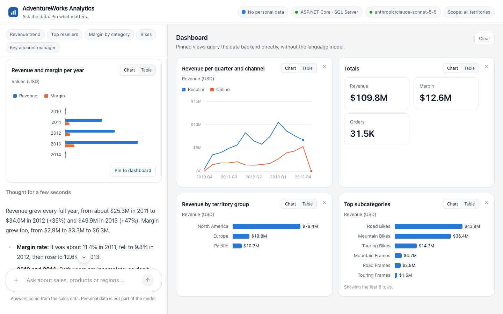

# Agentic Analytics with Angular

Ask a sales database questions in plain language and get charts back, right inside an Angular app.
Pin the answers you like to a dashboard that keeps working without the LLM.

The demo accompanies the article **[Agentic Analytics with Angular, CopilotKit and Mastra](https://angular.schule/blog/2026-11-agentic-analytics)** on angular.schule.
It was inspired by Manfred Steyer's live-coding workshop *Build an Agentic Analytics App with Angular* ([his demo](https://github.com/manfredsteyer/agentic-sales)) and rebuilt with its own data, its own backends and a strong focus on data protection.



## What it shows

- **Generative UI with Angular and CopilotKit.** The agent's tool calls are rendered as Angular components: line, bar and stat charts, tables, and product cards with photos.
- **AG-UI** as the protocol between the Angular app and the agent, streamed as server-sent events.
- **The same agent, built twice:** with Mastra (TypeScript) and with the Microsoft Agent Framework (C#). Same system prompt, same two tools, and the tool schemas are generated from the semantic layer, so the model only knows names that exist. The Angular app draws both alike.
- **The agent in the backend or as a separate service.** By default it runs in the backend's process: Mastra inside NestJS, the Microsoft Agent Framework inside ASP.NET Core. A separate Mastra service in front of either backend is one profile away.
- **A semantic layer instead of SQL.** The model chooses measures, dimensions and filters. It never writes SQL; the backends validate every request and pass values as parameters.
- **Data minimisation.** Company names are part of the data, people are not: no sales representatives, key account managers or contact persons. The database account of the backends can only read three views that contain no personal data, filtered to a configurable territory.
- **Two interchangeable backends** with the same HTTP contract and the same AdventureWorks data: ASP.NET Core with Entity Framework Core and SQL Server, or NestJS with Drizzle and PostgreSQL. Each generates its OpenAPI document from its own code and shows it in Swagger UI; contract tests make sure both documents describe the same contract and both backends give identical answers.
- **A dashboard without tokens.** A pinned view stores the query, not the numbers. Tiles ask the backend directly.

## Architecture

Default: the agent runs in the backend.

```
Browser (Angular + CopilotKit)
  │  /agent  AG-UI over SSE    /api  pinned tiles, product photos
  ▼                            ▼
Backend (one of) ───────────────────────────────────▶ LLM provider
  ├─ ASP.NET Core + Microsoft Agent Framework + EF Core ─▶ SQL Server 2025
  └─ NestJS + Mastra + Drizzle ──────────────────────────▶ PostgreSQL 17
```

With the profile `agent`: a separate Mastra service between browser and backend.

```
Browser ── /agent ──▶ Agent (Mastra, Node.js) ── /api ──▶ Backend (one of)
   └────── /api ──────────────────────────────────────────▶
```

| Folder | Content |
| --- | --- |
| `frontend/` | Angular app with CopilotKit, served by nginx in the container |
| `agent/` | Mastra agent as a separate service with an AG-UI endpoint |
| `backends/dotnet/` | ASP.NET Core minimal API, EF Core, SQL Server; the agent with the Microsoft Agent Framework in `Agent/` |
| `backends/node/` | NestJS on Fastify, Drizzle, postgres.js; the agent with Mastra in `src/agent/` |
| `db/` | Database images: import of AdventureWorksDW, analytics views, read-only role |
| `contract/` | Tests that compare both backends: OpenAPI documents, answers, and the agent endpoint |

## Quick start

Requirements: Docker with Compose, and an API key of an LLM provider.

```bash
cp .env.example .env              # database passwords and DATA_SCOPE
cp agent/.env.example agent/.env  # model and API key

docker compose --profile node up --build     # NestJS + Mastra + PostgreSQL
# or
docker compose --profile dotnet up --build   # ASP.NET Core + Microsoft Agent Framework + SQL Server
```

The agent as a separate Mastra service, in front of either backend:

```bash
AGENT_URL=http://agent:4111 docker compose --profile node --profile agent up --build
```

Then open <http://localhost:8080>. The backend's Swagger UI opens at <http://localhost:8081> (.NET) or <http://localhost:8082> (Node).
The first start imports the AdventureWorks data and takes a few minutes.
SQL Server is published for amd64 only; on Apple Silicon it runs emulated and needs about 2 GB of memory for the Docker VM.

### Switching the model

`agent/.env` configures the agent, wherever it runs. Set `MODEL` to `provider/model` and add the provider's key.
Mastra's model router knows all three providers below; the ASP.NET Core backend talks to Anthropic only, through Anthropic's .NET SDK.

```bash
MODEL=anthropic/claude-sonnet-5-5   # ANTHROPIC_API_KEY
MODEL=openai/gpt-5.6-terra          # OPENAI_API_KEY
MODEL=google/gemini-3-flash-preview # GOOGLE_GENERATIVE_AI_API_KEY
```

### Restricting the data

`DATA_SCOPE` in `.env` limits what the backends may see: `*` for everything, or one territory group (`Europe`, `North America`, `Pacific`).
The restriction is enforced in the database: the views filter by a session value that the backend sets for every connection (read-only session context in SQL Server, a connection parameter in PostgreSQL). Without that value the views return no rows.

## Development without Docker

Each part can run on its own, against databases started with Compose:

```bash
docker compose --profile node up postgres

cd backends/node && npm ci && npm run build && \
  DATABASE_URL=postgres://analytics_reader:<password>@127.0.0.1:5434/adventureworks PORT=8082 npm start

cd frontend && npm ci && DATA_API_URL=http://127.0.0.1:8082 npm start   # http://localhost:4200
```

The backend reads `MODEL` and the API key from its environment. For the separate agent service instead:

```bash
cd agent && npm ci && DATA_API_URL=http://127.0.0.1:8082 npm start
cd frontend && DATA_API_URL=http://127.0.0.1:8082 AGENT_URL=http://127.0.0.1:4111 npm start
```

With both backends running (.NET on 8081, Node on 8082, each with a model key), the contract tests compare their OpenAPI documents, their answers and their agent endpoints:

```bash
node --test 'contract/*.test.mjs'
```

## Data

The data is **AdventureWorksDW** by Microsoft, from [microsoft/sql-server-samples](https://github.com/microsoft/sql-server-samples), MIT License: sales of a fictitious bicycle manufacturer between December 2010 and January 2014.
SQL Server restores the original backup; PostgreSQL imports the CSV files of the same release.
Downloads are pinned to a commit and checked against SHA-256 checksums.

## Privacy notes

- The browser talks to one origin only. The app loads no fonts, scripts or telemetry from third parties.
- Mastra sends usage telemetry by default; the agent service and the NestJS backend switch it off (`MASTRA_TELEMETRY_DISABLED`).
- The CopilotKit Inspector, which reports usage when opened, is disabled.
- Whatever a tool returns goes to the LLM provider. That is why the semantic layer contains no personal data in the first place.
